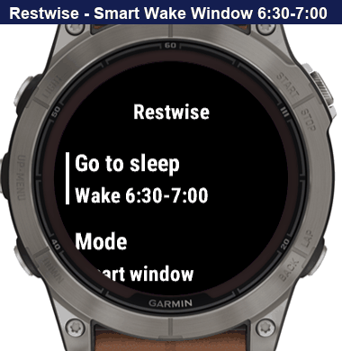

# Restwise: smart wake-up for Garmin watches

A Connect IQ watch app for the **Garmin Fenix 7 Pro** (SDK 9.1.0, API 5.2) that wakes you at the right moment instead of the loudest one. Built at the Tech Thursday × Garmin hackathon.

| | Feature | What it does |
|---|---|---|
| 1 | **Smart Wake Window** | You set a window (e.g. 6:30–7:00). Restwise wakes you at the first light/restless moment inside it, or at the end if you stay in deep sleep. The morning screen tells you *why* it woke you then. |
| 2 | **Quality Sleep Goal** | You set a goal (e.g. 7 h) and a latest wake time. Only time asleep counts toward the goal. Once it's banked (+15 min safety margin) Restwise waits up to 20 min for a light moment, and the latest wake time always wins. |

Neither feature exists natively on the Fenix 7 / 7 Pro. Feature 2 exists on no Garmin model. See [`reports/Sleep app feature report.pdf`](reports/) for the market and competitor research.



## How it works

Connect IQ apps can't read Garmin's own sleep stages, so Restwise labels every minute itself, from the watch's sensors:

```
accelerometer 25 Hz + heart rate 1 Hz
        │
EpochAggregator      one activity number per minute (|accel| − 1 g, milli-g)
        │
SleepStateEngine     AWAKE / RESTLESS / SETTLED  (causal Cole-Kripke + heart-rate rules)
        │
WakeDecider          SmartWakeDecider (F1) | QualityGoalDecider (F2)  → "wake now?" + reason
        │
NightSession         state machine, safety watchdog → AlarmDriver (ramping vibration → tone, snooze) + Store
        │
UI                   home menu · time picker · dark night screen · alarm · morning report
```

On one real lab-recorded night ([PhysioNet sleep-accel](https://physionet.org/content/sleep-accel/), Walch et al. 2019, subject 46343), the engine agrees with polysomnography **90.6%** for asleep vs awake, in line with published wrist-sensor results.

## Project layout

```
Restwise/          Connect IQ project (manifest.xml, monkey.jungle)
  source/foundation  shared types, settings, logging
  source/platform    sensors (live + replay), clock, alarm, storage: the only watch-API code
  source/core        pure logic: aggregator, sleep engine, wake deciders
  source/session     NightSession state machine
  source/ui          screens and button handling
  test/              44 unit tests (Toybox.Test)
  resources/demo     the replayed real night (per-minute JSON, ~6 KB)
scripts/           rw.ps1 (build/run/test), simctl.ps1 + simrec.ps1 (simulator control/recording)
tools/             PhysioNet → replay converter + engine check, demo GIF/MP4 maker
docs/              PLAN.md, DECISIONS.md (every design decision), HOW_TO_DEMO.md
demo/              10-second demo videos (MP4 + GIF)
reports/           research reports (idea evaluation, sleep app features)
```

## Build, test, run

Requires the Connect IQ SDK Manager with **SDK 9.1.0** and the **Fenix 7 Pro** device, plus a developer key at
`%USERPROFILE%\.connectiq\developer_key.der` (create one with VS Code → *Monkey C: Generate a Developer Key*, or edit `scripts/rw.ps1`).

```powershell
powershell -ExecutionPolicy Bypass -File .\scripts\rw.ps1 test    # 44 unit tests in the simulator
powershell -ExecutionPolicy Bypass -File .\scripts\rw.ps1 run     # build + launch on the Fenix 7 Pro simulator
```

In the app, choose **Demo night** to replay the real recorded night in about 45 s. Switch **Mode** to see Feature 2 (the demo uses a 3 h goal). See [`docs/HOW_TO_DEMO.md`](docs/HOW_TO_DEMO.md).

To regenerate the demo data you need the original PhysioNet files (not in the repo):

```
python -I tools/physionet_to_replay.py tools/data/physionet 46343 Restwise/resources/demo/demo_night.json
```

## Status and limits

- Tested with unit tests and end to end in the simulator using real recorded data. **Not yet worn overnight on a real watch.** Vibration/tone feel, overnight battery use and coexistence with Garmin's own sleep tracking still need a device test.
- Background code can't vibrate in Connect IQ, so the app must be started at bedtime and stay open overnight (screen stays dark).
- Sleep labels are an estimate from motion and heart rate, not lab-grade sleep staging.
- Planned next: night events / sleepwalking check (out-of-bed walks with time, steps and floor change).

## Data attribution

Demo night derived from the PhysioNet **sleep-accel** dataset: Walch O. et al., *Sleep stage prediction with raw acceleration and photoplethysmography heart rate data derived from a consumer wearable device*, SLEEP 2019; Goldberger A. et al., PhysioNet, 2000. See the dataset page for its licence terms.
